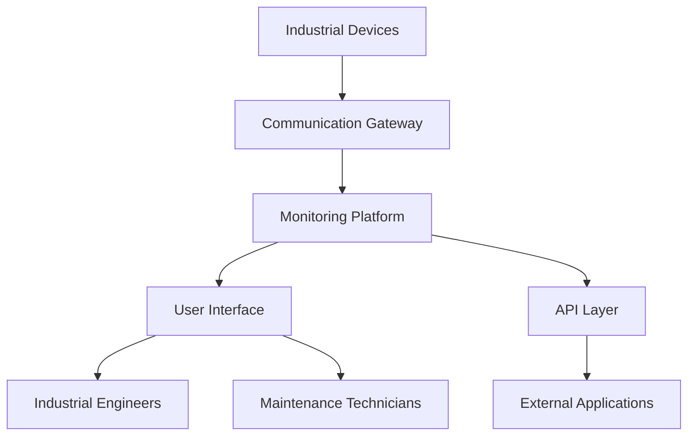

# Smart Industrial Monitoring Platform – Overview

## 1. Introduction

The Smart Industrial Monitoring Platform is a fictional industrial monitoring solution designed to help industrial facilities monitor connected electrical equipment, collect operational data, and identify equipment-related issues.

The platform provides a centralized interface for accessing equipment status, monitoring operating conditions, configuring connected devices, and managing system alerts.

This document introduces the platform, its key capabilities, major components, and intended users.

## 2. Purpose

The platform is designed to support industrial monitoring activities by providing:

- Centralized access to connected equipment information.
- Real-time visibility into equipment operating conditions.
- Device configuration and monitoring capabilities.
- Alert notifications for abnormal operating conditions.
- Access to equipment information through application programming interfaces (APIs).

## 3. Key Capabilities

### 3.1 Equipment Monitoring

Enables users to view the operational status and available monitoring parameters of connected industrial equipment.

### 3.2 Device Configuration

Allows authorized users to configure supported devices and update their monitoring parameters.

### 3.3 Alert Management

Provides notifications when monitored equipment reports abnormal conditions or predefined alert thresholds are exceeded.

### 3.4 Data Access and Integration

Provides API-based access to selected equipment information for integration with external applications.

### 3.5 Operational Visibility

Presents equipment information through a centralized monitoring interface to support operational analysis and troubleshooting.

## 4. Major System Components

The platform consists of the following logical components:

- **Industrial Devices:** Connected electrical equipment that provides operational data.
- **Communication Gateway:** Transfers data between connected devices and the monitoring platform.
- **Monitoring Platform:** Processes and manages incoming equipment information.
- **User Interface:** Allows authorized users to view equipment status, configure devices, and manage alerts.
- **API Layer:** Enables external applications to retrieve supported platform information.

## 5. Intended Users

The platform supports the following user groups:

- **Industrial Engineers:** Monitor equipment conditions and review operational information.
- **Maintenance Technicians:** Identify equipment issues and perform troubleshooting activities.
- **System Integrators:** Configure connected devices and integrate industrial systems.
- **Software Developers:** Access platform information through supported APIs.

## 6. Operating Principles

The platform follows a general monitoring workflow:

1. Connected industrial devices generate operational data.
2. The communication gateway transfers the data to the platform.
3. The platform processes and stores the received information.
4. Authorized users access equipment information through the user interface.
5. External applications retrieve supported information through APIs.
6. The platform generates alerts when configured monitoring conditions are met.

## 7. Scope and Limitations

This document describes the conceptual architecture and capabilities of the fictional platform.

Actual device compatibility, communication protocols, supported parameters, performance limits, and API functionality will be defined in the relevant technical documentation as the project develops.

## 8. System Architecture

The following diagram illustrates the high-level data flow between industrial devices, the communication gateway, the monitoring platform, and its users.

